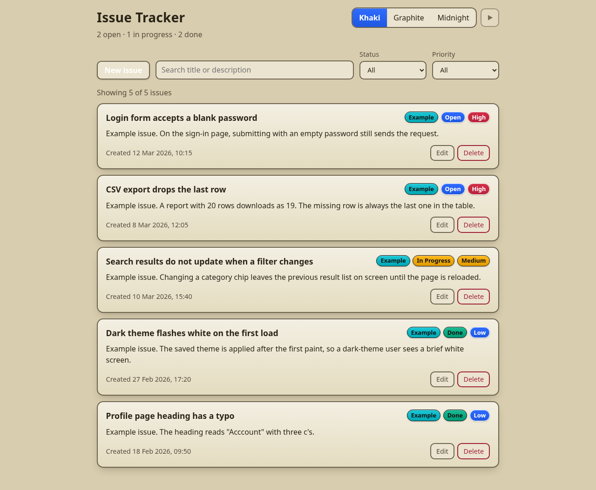
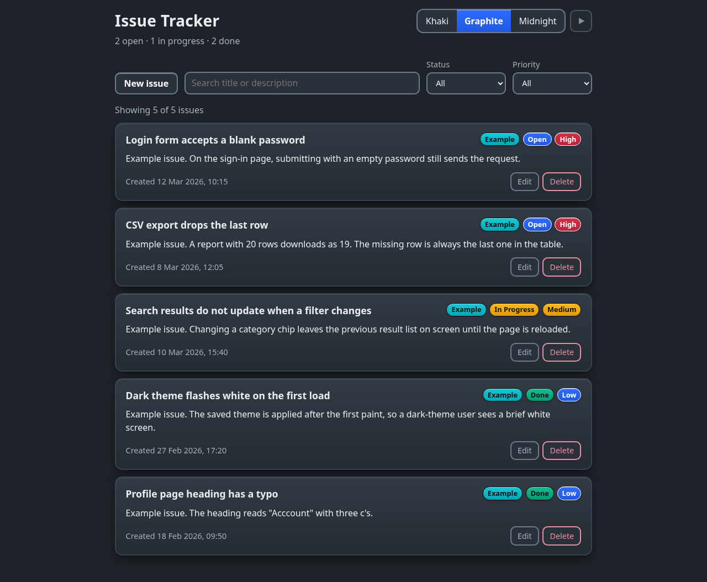
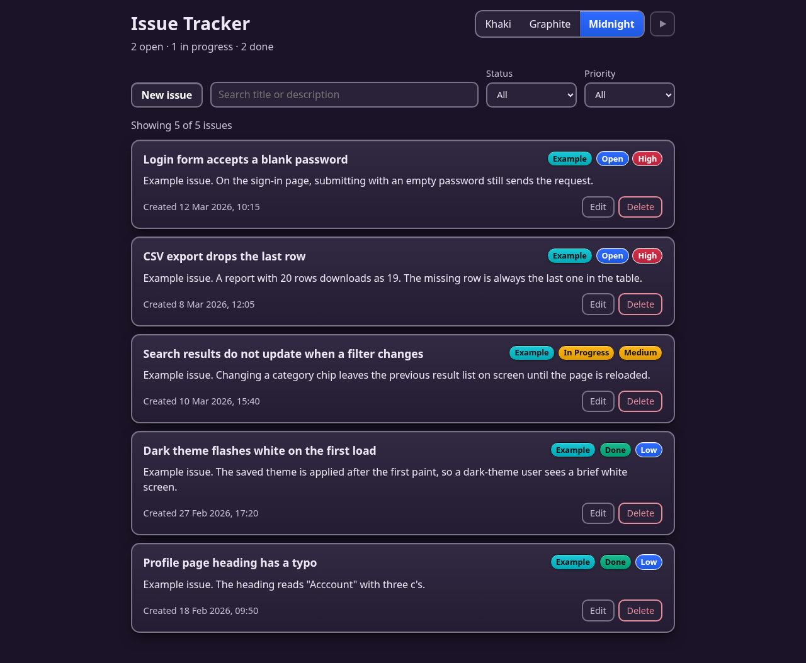

# Issue Tracker

**Live demo: https://ali1129js.github.io/issuetracker-app/**

Create, filter, edit and delete issues in the browser. Each issue has a title, a description, a status (Open, In Progress, Done), a priority and a created date. The list is saved in `localStorage`.

Rebuilt in 2026 (original 2020, AI pair-programmed 2026). The 2020 version was a Create React App class component with Bootstrap, no search, no edit, no confirmed delete and no persistence. This version keeps the original idea and adds those pieces in React 19 and strict TypeScript.

## Features

- New and edited issues, with a required title.
- Status and priority filters, plus search over title and description.
- Delete asks for confirmation, and Cancel leaves the issue in place.
- Seeded example issues, each marked with an **Example** badge. They appear only when storage is empty. If you delete them, they stay gone after a reload.
- Three themes from the gloss colour scheme: Khaki (the default light background), Graphite and Midnight. The first visit follows the operating system (`prefers-color-scheme`). The choice is remembered. A button next to the switch can turn on a slow, optional background motion; it stays off if you prefer reduced motion.
- Desktop first. At 390 px wide the layout stacks and does not scroll sideways.

Everything stays on your machine. There is no server and no account.

## Screenshots

Desktop, 1280 px wide, one per theme.

| Khaki | Graphite | Midnight |
|---|---|---|
|  |  |  |

## Stack

Vite, React 19, TypeScript (`strict`, `noUncheckedIndexedAccess`, `exactOptionalPropertyTypes`), Zod 4, Vitest and Testing Library, ESLint, Prettier.

## Scripts

```bash
npm install
npm run dev         # http://localhost:5173/
npm run lint
npm run typecheck
npm test
npm run build       # type-checks, then builds to dist/
npm run preview
```

See [docs/LEARN.md](docs/LEARN.md) for a short walk-through of the ideas used in the code.

The 2020 original (Create React App, Bootstrap) is kept for comparison at [docs/original-screenshot.png](docs/original-screenshot.png).

## Deploying

`.github/workflows/deploy.yml` runs lint, typecheck, tests and build on every push and pull request, and deploys `dist/` to GitHub Pages when `main` or `master` changes (Pages source: GitHub Actions).
